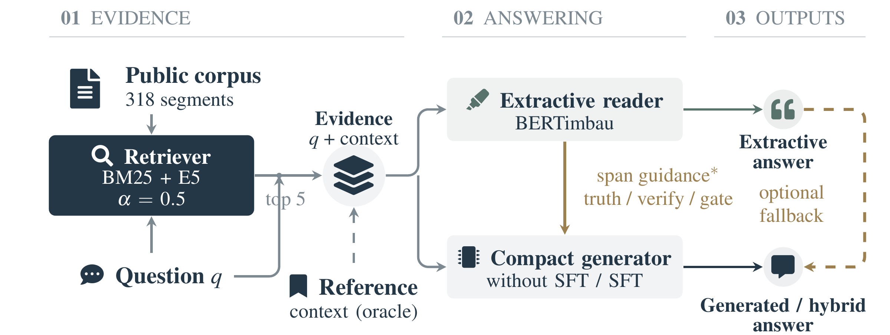
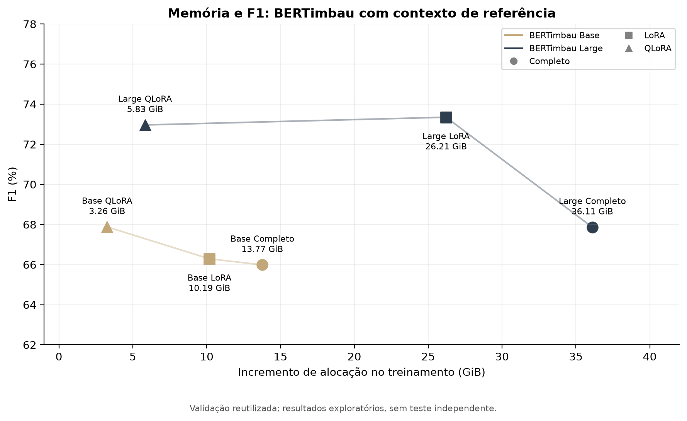
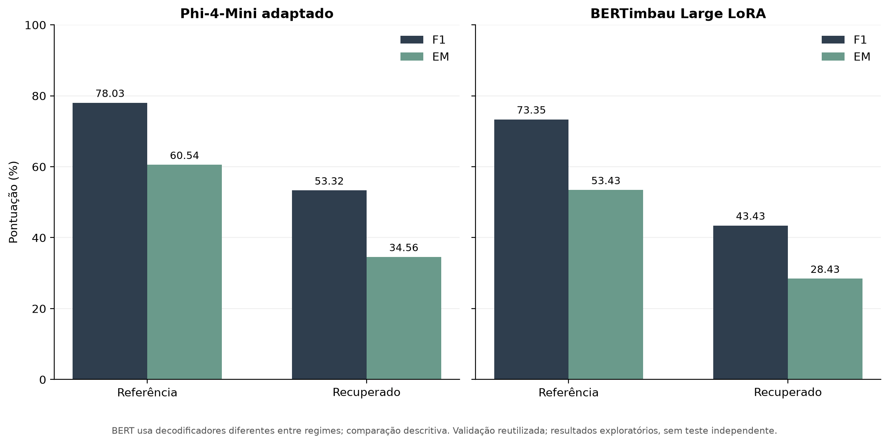

# Institutional-QA-PT

Respostas a perguntas em português sobre informações institucionais do Programa de Pós-Graduação em Ciência da Computação da UNIFESP.

Código, dataset e resultados do estudo **Local Institutional QA under Resource and Privacy Constraints: Benchmarking Extractive, Generative, and Verified Hybrid Pipelines in Portuguese**. O trabalho compara leitores extrativos, geradores com recuperação de documentos (RAG) e estratégias híbridas, incluindo ajuste completo, LoRA e QLoRA.

[Dataset · Zenodo](https://doi.org/10.5281/zenodo.23839298) · [Treinamento e inferência](docs/TRAINING.md) · [Resultados](docs/RESULTS.md) · [Figuras](docs/FIGURAS.md)

## Pipeline



A pergunta e os documentos recuperados alimentam um leitor extrativo ou um gerador compacto. Nas variantes híbridas, o trecho extraído orienta a geração, com estratégias de verificação, roteamento e fallback. O contexto de referência é uma condição experimental separada da recuperação.

[Diagrama em PDF](figures/pipeline.pdf) · [Fonte TikZ](figures/pipeline.tex)

## Dataset

| Conteúdo | Quantidade |
|---|---:|
| Perguntas originais | 514 |
| Paráfrases não vazias | 1.507 |
| Perguntas originais em treinamento / validação | 411 / 103 |
| Formulações em treinamento / validação | 1.613 / 408 |
| Segmentos indexados nas execuções históricas | 318 |

A divisão 80/20 usa semente 42 e agrupa as paráfrases pela pergunta original. O corpus inclui contextos, respostas e posições de caracteres para QA extrativo.

- **Corpus:** [`data/processed/corpus_completo.json`](data/processed/corpus_completo.json).
- **Documentos para recuperação:** [`data/documents/`](data/documents/).
- **Divisão dos dados:** [`reproducibility/split_manifest.json`](reproducibility/split_manifest.json).
- **Versão publicada:** [Zenodo · 1.0.0](https://doi.org/10.5281/zenodo.23839298). O depósito contém o JSON do corpus; os demais artefatos estão neste repositório.

## Uso

### Verificar os resultados distribuídos

Com Python 3.10 ou superior, execute na raiz do repositório:

```bash
python scripts/verify_artifact.py
```

A verificação usa apenas a biblioteca padrão, sem GPU ou download de modelos. Confere a integridade dos arquivos, os contatos revisados, as posições das respostas, a divisão dos dados e as métricas das predições salvas, incluindo as tabelas e os intervalos bootstrap.

### Treinar e avaliar modelos

As dependências, os modelos e os exemplos de execução estão em [Treinamento e inferência](docs/TRAINING.md). Os principais pontos de entrada são:

| Etapa | Script |
|---|---|
| Preparação dos documentos | `preprocess_docs.py` |
| Recuperação BM25, densa e híbrida | `scripts/retriever.py` |
| Treinamento de leitores extrativos | `scripts/train_unifesp_qa.py` |
| Adaptação supervisionada de geradores | `scripts/train_llm_rag.py` |
| Avaliação generativa | `scripts/evaluate_generative_rag.py` |
| Avaliação híbrida | `scripts/evaluate_hybrid_rag.py` |

Checkpoints e adaptadores não estão incluídos. A auditoria reproduz as métricas das predições distribuídas; o ambiente e as revisões históricas não permitem garantir reprodução idêntica do treinamento.

## Resultados

### Memória e qualidade das respostas



Comparação de BERTimbau Base e Large com contexto de referência. A memória corresponde ao incremento registrado de alocação durante o treinamento, em GiB; não representa o pico total de VRAM nem uma medida de energia.

### Contexto de referência e contexto recuperado



As condições com contexto de referência e recuperado são apresentadas separadamente. Os protocolos de decodificação de BERT diferem entre regimes; esta comparação não isola o efeito da recuperação.

**Limites da avaliação.** O mesmo holdout foi usado para selecionar checkpoints e limiares; não há teste independente. Os resultados são exploratórios. Os intervalos bootstrap das diferenças híbridas incluem zero e não corrigem o viés de seleção. Consulte as [tabelas e a análise completa](docs/RESULTS.md) e a [galeria de figuras](docs/FIGURAS.md).

## Estrutura

```text
data/              Corpus de QA e documentos institucionais
scripts/           Treinamento, recuperação, avaliação e verificação
results/           Predições e resumos experimentais
reproducibility/   Auditoria, divisão dos dados e proveniência
figures/           Gráficos e diagrama do pipeline
figures/paper/     Figuras preservadas do manuscrito
docs/              Guias de uso, resultados e privacidade
environment/       Registros dos pacotes observados no cluster
```

## Citação

Ao utilizar o dataset, cite a versão publicada:

> Nina Capujra, M. M., Paye Mamani, J. E., & Vega Oliveros, D. A. (2026). *Institutional-QA-PT: A Portuguese Question Answering Dataset for Institutional Information* (Version 1.0.0) [Dataset]. Zenodo. https://doi.org/10.5281/zenodo.23839298

## Licenças e privacidade

- **Código original:** [MIT](LICENSE).
- **Corpus `corpus_completo.json`:** [CC BY 4.0](https://creativecommons.org/licenses/by/4.0/), conforme o depósito no Zenodo.
- **Material de terceiros:** documentos institucionais e modelos permanecem sujeitos aos direitos e às condições de suas fontes. A licença MIT não se aplica ao dataset nem concede direitos sobre material de terceiros ou outros artefatos não classificados como código.

O corpus passou por substituição de e-mails individuais, links de perfis pessoais e do nome do representante discente. Nomes públicos de docentes, contatos gerais e links para listas institucionais de alunos e egressos permanecem. **O dataset não é totalmente anônimo.** A [revisão de privacidade](docs/PRIVACIDADE.md) descreve o tratamento e seus limites.
