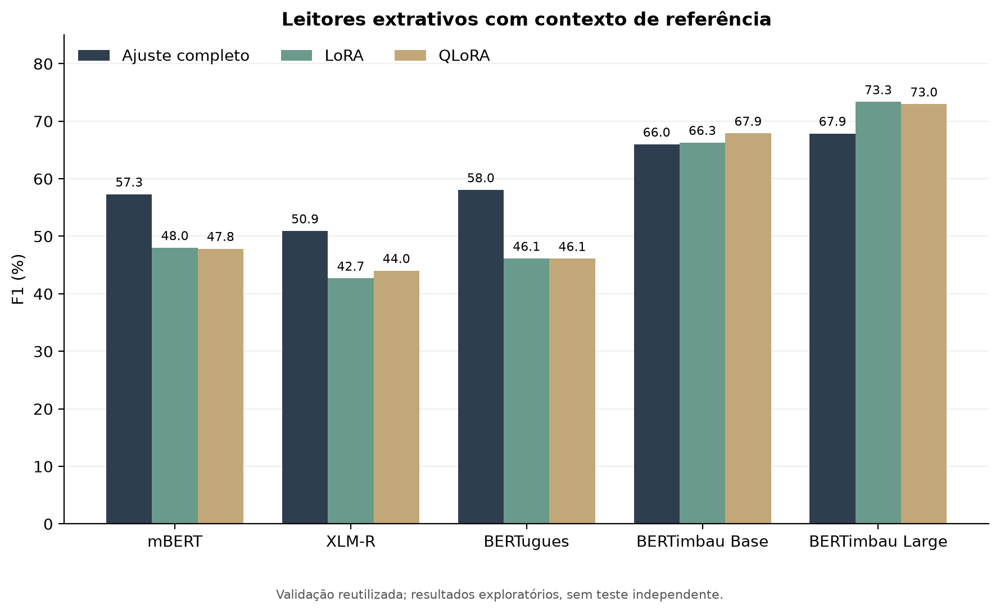
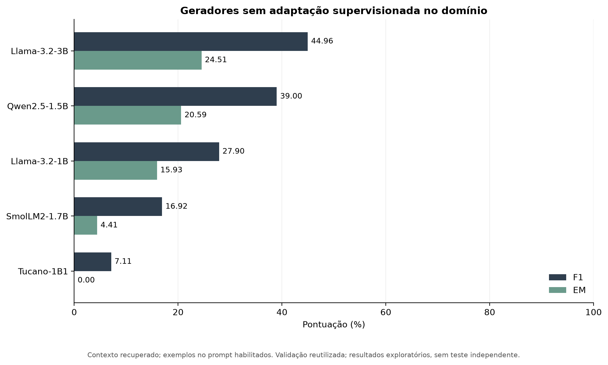
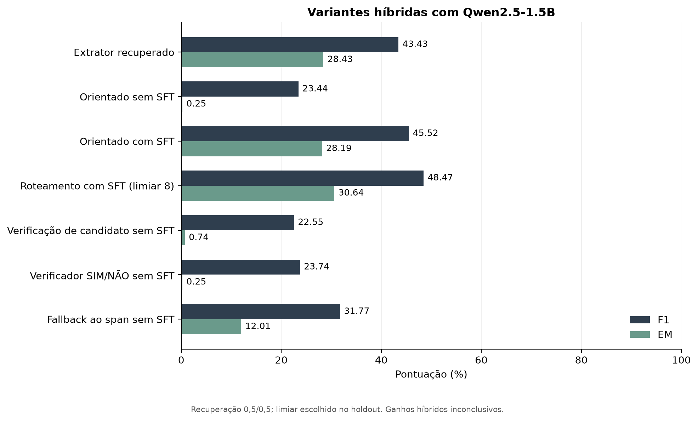
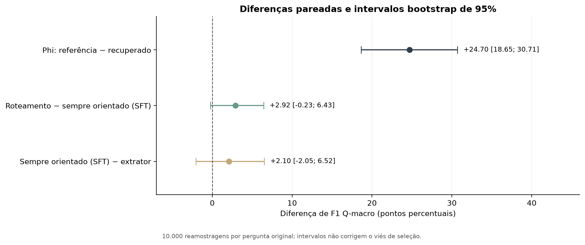
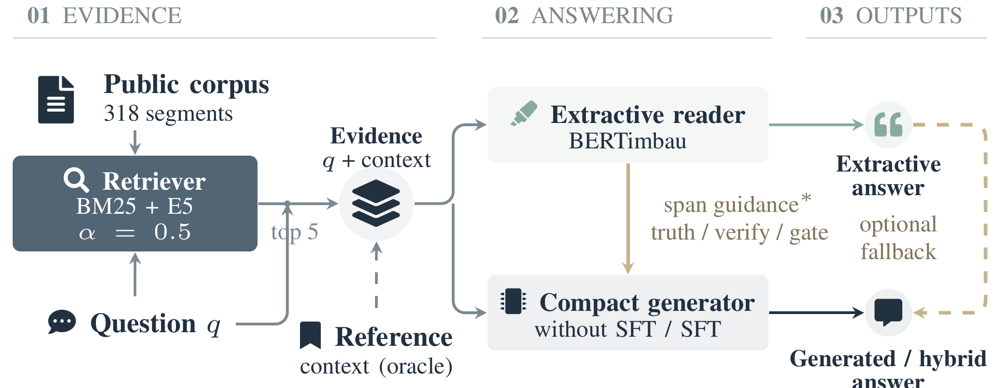
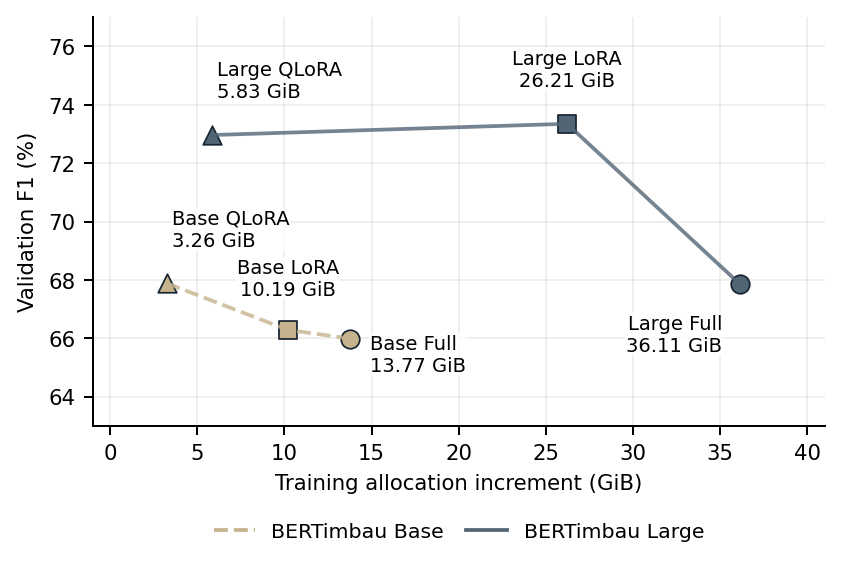
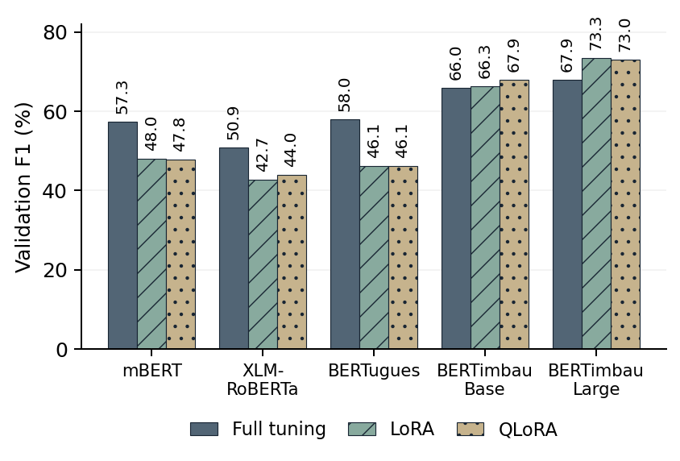

# Galeria de figuras

Os gráficos explicativos abaixo são gerados por `python scripts/generate_figures.py` a partir de `reproducibility/verified_results.json`. Cada gráfico é distribuído em PNG para leitura e PDF para exportação. Não há números experimentais novos nem treinamento adicional.

Todas as estimativas usam validação reutilizada para seleção. As figuras não representam desempenho em teste independente. As versões em português são material explicativo adicional; não substituem as figuras do manuscrito.

## Leitores extrativos

Melhor F1 de validação por modelo e estratégia, com contexto de referência. A seleção entre configurações ocorreu no mesmo holdout.

[Baixar PDF](../figures/extractive_f1.pdf)

## Memória e F1

Incremento registrado de alocação durante o treinamento, em GiB. Não é o pico total da GPU nem uma medida de energia. Os limites verticais foram ampliados para legibilidade das diferenças, e os pontos não indicam equivalência estatística.

[Baixar PDF](../figures/memory_f1.pdf)

## Geradores com contexto recuperado

Compara os cinco geradores sem adaptação supervisionada no domínio, com exemplos fixos no prompt. F1 mede sobreposição de tokens; EM exige correspondência exata após normalização.

[Baixar PDF](../figures/generators_retrieved.pdf)

## Sensibilidade ao contexto

Contexto de referência e recuperado aparecem separadamente para Phi adaptado e BERTimbau Large LoRA. Os protocolos de decodificação BERT diferem entre regimes; os números não isolam causalmente o efeito do ranking nem estabelecem superioridade geral entre arquiteturas.

[Baixar PDF](../figures/context_comparison.pdf)

## Variantes híbridas

Mostra o extrator recuperado e variantes Qwen com ou sem adaptação supervisionada (SFT). O limiar 8 foi selecionado no holdout. A recuperação usa pesos 0,5/0,5. As diferenças são exploratórias, e verificação por modelo não demonstra correção semântica.

[Baixar PDF](../figures/hybrid_variants.pdf)

## Diferenças pareadas e incerteza

Diferenças de F1 Q-macro, com 10.000 reamostragens bootstrap por pergunta original. A linha zero indica ausência de diferença. Os dois intervalos das comparações híbridas incluem zero. Os intervalos não corrigem a seleção de modelos e limiares na validação.

[Baixar PDF](../figures/paired_differences.pdf)

## Figuras do paper

Estas são cópias exatas dos arquivos usados pelo manuscrito local revisado. Mantêm os rótulos em inglês. Seus checksums estão em `reproducibility/paper_figure_manifest.json`; o gerador dos gráficos em português não as sobrescreve.

[Pipeline em PDF](../figures/paper/pipeline_preview.pdf) · [Fonte TikZ](../figures/paper/pipeline.tex)

[Comparação extrativa em PDF](../figures/paper/fig3_barras.pdf) · [Memória/F1 em PDF](../figures/paper/fig1_green_ai.pdf) · [Pipeline em PDF](../figures/paper/pipeline_preview.pdf)

A fonte exata do diagrama do manuscrito está em `figures/paper/pipeline.tex`. O diagrama editável adicional está em `figures/pipeline.tex`. `python scripts/build_pipeline.py` recompila uma cópia em `figures/pipeline.pdf` quando LaTeX e os pacotes necessários estão disponíveis.
